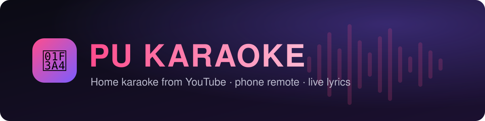
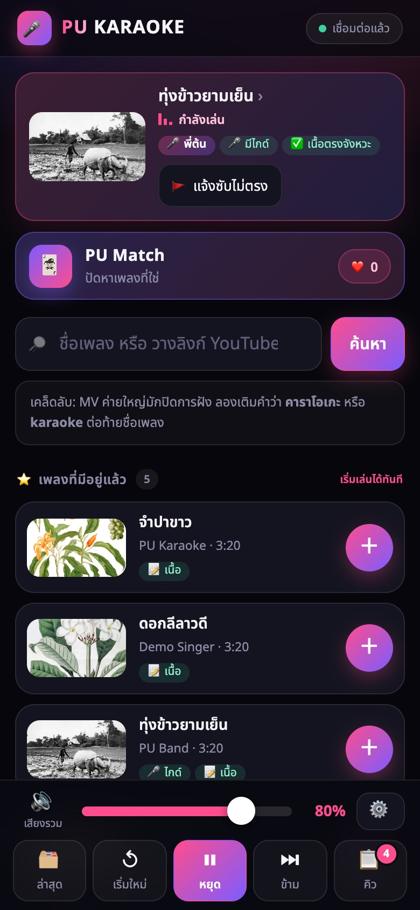
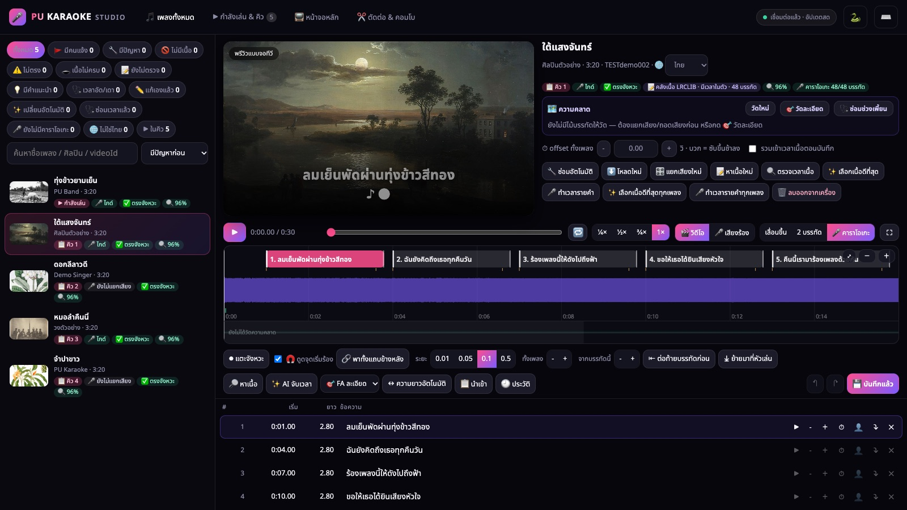
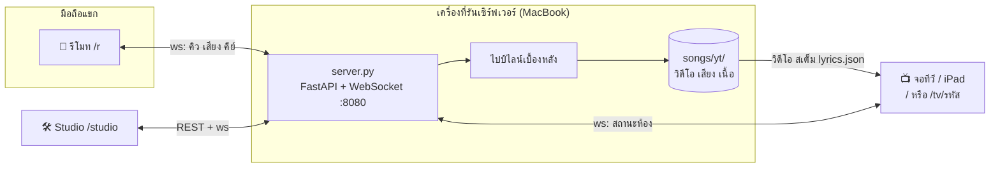
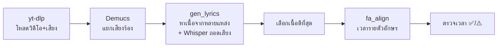

<p align="center">
  
</p>

<p align="center">
  <b>คาราโอเกะในบ้านจาก YouTube: สั่งเพลงจากมือถือ ร้องบนจอทีวี เนื้อเพลงไล่สีตามจังหวะ</b><br>
  <sub>Home karaoke server: phone remote, TV screen, AI vocal removal and auto-timed Thai/English lyrics</sub>
</p>

<p align="center">
  
  
  
  
  
  
</p>

<p align="center">
  
  &nbsp;
  
</p>

> ภาพหน้าจอถ่ายจากเพลงตัวอย่างในคลังทดสอบ (ภาพพื้นหลังเป็นสาธารณสมบัติ เนื้อเพลงแต่งขึ้นสำหรับเดโม)

---

## สารบัญ

- [ทำอะไรได้บ้าง](#-ทำอะไรได้บ้าง)
- [ทำงานอย่างไร](#-ทำงานอย่างไร)
- [เริ่มใช้งาน (macOS)](#-เริ่มใช้งาน-macos)
- [ใช้ในงานจริง](#-ใช้ในงานจริง)
- [Windows / Linux](#-windows--linux)
- [ตั้งค่าผ่าน environment](#%EF%B8%8F-ตั้งค่าผ่าน-environment)
- [โครงสร้างโปรเจกต์](#-โครงสร้างโปรเจกต์)
- [ทำต่อด้วย AI (Claude Code / Codex / Cursor)](#-ทำต่อด้วย-ai)
- [ปัญหาที่พบบ่อย](#-ปัญหาที่พบบ่อย)
- [ผู้สร้างและสัญญาอนุญาต](#-ผู้สร้าง)

---

## ✨ ทำอะไรได้บ้าง

| | |
|---|---|
| 📱 **รีโมทบนมือถือ** (`/r`) | แขกสแกน QR บนจอแล้วค้นเพลงจาก YouTube, เพิ่มคิว, ใส่ชื่อคนร้อง, ปรับเสียงไกด์/ดนตรี/คีย์ ไม่ต้องลงแอป |
| 📺 **จอทีวี** (`/` หรือ `/tv/<รหัส>`) | เล่นวิดีโอพร้อมเนื้อเพลง 3 แบบ: เลื่อนขึ้น / 2 บรรทัด / **คาราโอเกะไล่สีรายตัวอักษร** ใช้ iPad หรือ Smart TV เป็นจอได้ |
| 🎙 **แยกเสียงร้องด้วย AI** | Demucs แยกเสียงร้องออกจากดนตรี เลยปรับเสียงไกด์และเปลี่ยนคีย์ได้ทุกเพลง |
| 📝 **หาเนื้อและจับเวลาอัตโนมัติ** | หาเนื้อจาก lrclib, ซับ YouTube, YouTube Music, JOOX, NetEase แล้วถอดเสียงด้วย Whisper และจับเวลาละเอียดด้วย forced alignment (wav2vec2 ภาษาไทย) |
| ✅ **ป้ายความมั่นใจ** | ตรวจว่าเนื้อตรงจังหวะไหม (✅ / ⚠️) แขกกด 🚩 แจ้งซับไม่ตรงได้ |
| 🛠 **Studio** (`/studio`) | หน้าแอดมิน: แก้เนื้อ, เลื่อนเวลา, แตะจังหวะ, แผนที่ความคลาด, ซ่อมอัตโนมัติ, ตั้งค่าจอทีวี, ตัดต่อเพลงและทำคอมโบ |
| 🃏 **PU Match** | ปัดหาเพลงแบบ Tinder จากคลังในเครื่อง |
| 🎬 **เปลี่ยนเพลงสวย ๆ** | เฟดดำ, ข้ามอินโทร ⏩, ตัดจุดเริ่ม-จบรายเพลง ✂️, ต่อหลายเพลงเป็นคอมโบ |
| 🌐 **เข้าจากนอกบ้าน** | Cloudflare Tunnel ให้ลิงก์ https ฟรี (ไม่บังคับ) |

<p align="center">
  
  <br><sub>Studio: พรีวิวแบบจอทีวี, แถบคลื่นเสียง, ตารางบรรทัด, ปุ่มซ่อมและจับเวลาอัตโนมัติ</sub>
</p>

---

## 🧠 ทำงานอย่างไร



**เมื่อมีคนเพิ่มเพลง** เซิร์ฟเวอร์ทำงานเบื้องหลังตามลำดับนี้ (เพลงที่ใกล้ถึงคิวได้ทำก่อน):



ทุกขั้นเก็บผลเป็นไฟล์ในโฟลเดอร์เพลง (`songs/yt/<ชื่อคลิป [videoId]>/`) ถ้าปิดเครื่องกลางทาง เปิดใหม่ก็ทำต่อจากเดิม รายละเอียดอยู่ใน [docs/ARCHITECTURE.md](docs/ARCHITECTURE.md)

---

## 🚀 เริ่มใช้งาน (macOS)

> ตัวหลักพัฒนาและใช้งานจริงบน **MacBook Apple Silicon (M-series) RAM 16 GB** ถ้าใช้ Windows หรือ Linux ให้อ่าน [docs/PORTING.md](docs/PORTING.md)

### 1. ติดตั้งของที่ต้องมี

```bash
# Homebrew: https://brew.sh
brew install python@3.12 ffmpeg node
# node: yt-dlp ใช้แก้โจทย์ JavaScript ของ YouTube ตอนโหลดแบบล็อกอิน
# Google Chrome: ใช้เป็นจอหลัก และใช้ล็อกอิน YouTube (ลดปัญหา "ยืนยันว่าไม่ใช่บอท")
```

### 2. โหลดโค้ดแล้วรัน

```bash
git clone https://github.com/promxxpurich/PU-Karaoke.git
cd PU-Karaoke
./run.sh          # ครั้งแรกสร้าง .venv และติดตั้งแพ็กเกจเอง (5–10 นาที)
```

### 3. โหลดโมเดล AI (ครั้งเดียว ~10 GB)

Demucs และ Whisper โหลดเองตอนใช้ครั้งแรก แต่โมเดลจับเวลาละเอียด (FA) **ไม่โหลดกลางงาน** ต้องสั่งโหลดเอง:

```bash
HF_HOME=.cache/hf HF_HUB_CACHE=.cache/hf/hub .venv/bin/python -c "
from huggingface_hub import snapshot_download as d
for m in ['airesearch/wav2vec2-large-xlsr-53-th',
          'facebook/wav2vec2-large-960h-lv60-self',
          'mlx-community/whisper-large-v3-turbo']:
    print('⬇', m); d(m)"
```

ถ้ายังไม่โหลด FA ระบบก็ยังใช้ได้ แต่จะไม่มีโหมดไล่สีคาราโอเกะ

### 4. เปิดใช้

| หน้า | ลิงก์ | ใครใช้ |
|---|---|---|
| จอหลัก | `http://localhost:8080/` (เปิดได้เฉพาะบนเครื่องที่รัน) หรือ `./player.command` | ต่อทีวี |
| จอหลักบนเครื่องอื่น | `http://<IP เครื่อง>:8080/tv/<รหัส>` (รหัสอยู่ใน `.studio.json` ช่อง `tv`) | iPad / Smart TV |
| รีโมท | สแกน QR บนจอ หรือ `http://<IP เครื่อง>:8080/r` | แขกทุกคน |
| Studio | `http://<IP เครื่อง>:8080/studio` (PIN อยู่ใน `.studio.json`) | เจ้าของงาน |

ไฟล์ `.studio.json` ถูกสร้างเองตอนรันครั้งแรก มี PIN สุ่ม 4 หลักและรหัสจอทีวี แก้ในไฟล์ได้เลยโดยไม่ต้องรีสตาร์ท

---

## 🎉 ใช้ในงานจริง

นี่คือวิธีที่ผู้สร้างใช้งานบน MacBook ทุกวัน:

1. **เปิดเซิร์ฟเวอร์:** `./run.sh` ใน Terminal (หรือ `python -u server.py` ใน `.venv`) แล้วเปิดค้างไว้ log อยู่ที่หน้าต่างนั้น
2. **เปิดจอหลัก:** ดับเบิลคลิก `player.command` (Chrome เต็มจอ, `--kiosk` ถ้าจะตั้งทิ้งไว้) หรือใช้ **iPad เป็นจอ** ผ่าน `/tv/<รหัส>` แล้วต่อ HDMI/AirPlay เข้าทีวี
3. **แขกสแกน QR** บนจอ แล้วสั่งเพลงจากมือถือ ทุกคนต้องอยู่ WiFi เดียวกัน (หรือใช้ Cloudflare ด้านล่าง)
4. **แก้เนื้อใน Studio** ระหว่างงานได้เลย เพลงที่มีคนกด 🚩 จะขึ้นในตัวกรอง "มีคนแจ้ง"
5. **ปิด:** ดับเบิลคลิก `stop.command` (ปิดเฉพาะเซิร์ฟเวอร์ของโปรเจกต์นี้และจอหลัก)

เครื่องมืออื่น:
- `./update.sh` ใช้ตอนค้นเพลงไม่เจอหรือโหลดไม่ได้ (อัปเดต yt-dlp + certificate)
- `./cloudflare.command --quick` เปิดลิงก์ https ชั่วคราวให้เข้าจากนอกบ้าน หรือ `./cloudflare.command kara.example.com` ถ้ามีโดเมนบน Cloudflare
- เนื้อที่แก้ใน Studio ถูกสำรองไว้ใน `lyrics-in/<videoId>.json` (อยู่ใน git) ลบคลังเพลงแล้วโหลดใหม่ เนื้อที่แก้ไว้ก็ยังอยู่

**ข้อควรรู้:**
- งาน AI (แยกเสียง, ถอดเสียง, จับเวลา) ใช้ GPU ของ Mac (Metal/MPS) เพลงใหม่ใช้เวลาเตรียมประมาณ 30–60 วินาทีต่อเพลง ระหว่างนั้นร้องกับวิดีโอต้นฉบับไปก่อนได้
- คลิปยาวเกิน 10 นาทีไม่แยกเสียง (กันเครื่องร้อน) และการค้นหาซ่อนคลิปที่ไม่ใช่เพลง (ไลฟ์, รีแอค, สัมภาษณ์ ฯลฯ)
- iPad ส่วนใหญ่เล่นวิดีโอ AV1 ไม่ได้ เพลงใหม่จึงโหลดเป็น H.264 ส่วนเพลงเก่าที่เป็น AV1 จะเล่นเป็นเสียง + เนื้อแทน (ตั้งใจไม่แปลงไฟล์ในเครื่องเพราะเครื่องร้อน)
- YouTube บางครั้งถาม "ยืนยันว่าไม่ใช่บอท" เซิร์ฟเวอร์จึงอ่านล็อกอิน YouTube จาก Chrome (macOS จะถามสิทธิ์ Keychain ให้กด **Always Allow**) ปิดได้ด้วย `KARA_YT_COOKIES=none`

---

## 🪟 Windows / Linux

ใช้ได้ แต่ต้องแก้โค้ดบางจุด เพราะตัวถอดเสียง (`mlx-whisper`) และ OCR ใช้ได้แค่บน Mac และสคริปต์ `.command` เขียนสำหรับ macOS

👉 **[docs/PORTING.md](docs/PORTING.md)** อธิบายทีละขั้น:
- **Linux + การ์ดจอ NVIDIA** เร็วพอ ๆ กับ Mac หลังแก้ 3 จุด
- **Windows** แนะนำให้ใช้ผ่าน WSL2 (Ubuntu) แทน native
- **เครื่องไม่มี GPU** ใช้ได้แต่ช้ากว่า

---

## ⚙️ ตั้งค่าผ่าน environment

ไม่ต้องตั้งอะไรก็ใช้ได้ ค่าเหล่านี้ไว้ปรับเฉพาะกรณี:

| ตัวแปร | ค่าเริ่มต้น | ใช้ทำอะไร |
|---|---|---|
| `KARA_YT_COOKIES` | `chrome` | อ่านล็อกอิน YouTube จากเบราว์เซอร์: `chrome`, `chrome:Profile 1`, `safari`, `firefox`, `none` |
| `KARA_STUDIO_PIN` | (จาก `.studio.json`) | บังคับ PIN ของ Studio |
| `KARA_ALLOWED_HOSTS` | (ว่าง) | โดเมนเพิ่มเติมที่ยอมให้เข้า (คั่นด้วย `,`) |
| `KARA_ASR_MODEL` | `mlx-community/whisper-large-v3-turbo` | โมเดล Whisper ที่ใช้ถอดเสียง |
| `KARA_FA_WORKER` | `on` | `off` = ไม่ค้างโมเดลจับเวลาไว้ในหน่วยความจำ |
| `KARA_FA_IDLE` | `0` | วินาทีที่ว่างแล้วปิดโมเดล FA เอง (`0` = ค้างตลอด, ใช้ RAM ~2.6 GB) |
| `KARA_WARM` | `on` | `off` = ไม่โหลดโมเดลล่วงหน้าตอนเปิดเซิร์ฟเวอร์ |
| `KARA_REFINE` | `on` | ซ่อมเวลาเนื้ออัตโนมัติหลังจับเวลา |
| `KARA_NO_TUNNEL` | (ว่าง) | `1` = `player.command` ไม่เปิด Cloudflare |

---

## 📁 โครงสร้างโปรเจกต์

```
server.py              เซิร์ฟเวอร์ทั้งหมด: หน้าเว็บ, API, WebSocket, คิว, ไปป์ไลน์เบื้องหลัง
static/
  remote.html          รีโมทมือถือ (/r)
  player.html          จอทีวี (/ และ /tv/<รหัส>)
  studio.html          Studio (/studio)
  mv/                  เครื่องยนต์ "MV จากเนื้อเพลง" + คลังฉาก (ภาพสาธารณสมบัติ)
lyrics_check.py        ตรวจเวลาเนื้อ / ป้ายความมั่นใจ ✅⚠️
make_wanted.py         สรุปที่มาเนื้อทุกเพลง -> lyrics-in/WANTED.tsv
scripts/
  gen_lyrics.py        หาเนื้อจากหลายแหล่ง + Whisper ถอดเสียง
  fa_align.py          forced alignment เวลารายตัวอักษร
  lyrics_refine.py     ซ่อมเวลาอัตโนมัติ
  verify_lyrics.py …   ตรวจและซ่อมเนื้อ
  test_tv_lyrics.py    ทดสอบจอทีวีด้วย headless Chrome
  eval_lyrics.py       วัดคุณภาพเนื้อทั้งคลัง
lyrics-in/             เนื้อที่แก้เองใน Studio (สำรองถาวร, อยู่ใน git)
tv.json                ค่าเริ่มต้นหน้าตาจอทีวี (สี ขนาดซับ ฯลฯ)
run.sh / update.sh     เริ่มเซิร์ฟเวอร์ / ซ่อม yt-dlp
*.command              ปุ่มดับเบิลคลิกบน macOS (เปิดจอ, ปิด, Cloudflare)
.claude/skills/kara-edit/  แผนที่โค้ดสำหรับ AI (MAP.md + kmap.py)
```

**ไม่อยู่ใน git** (สร้างใหม่เองหรือเป็นข้อมูลส่วนตัว):

| โฟลเดอร์/ไฟล์ | คืออะไร | ได้มาอย่างไร |
|---|---|---|
| `songs/` | วิดีโอ เสียง สเต็ม เนื้อที่ระบบทำให้ (หลาย GB) | สร้างเองเมื่อสั่งเพลง |
| `.cache/` | โมเดล AI (~10 GB) | ดูขั้นที่ 3 |
| `.venv/` | Python packages | `./run.sh` สร้างให้ |
| `lyrics-preview/` | แคชงานถอดเสียง/จับเวลา | สร้างเอง |
| `.studio.json` | PIN, secret, รหัสจอทีวี, ลิงก์สาธารณะ | สร้างเองตอนรันครั้งแรก |
| `history.json` | ประวัติใครร้องอะไร | สร้างเอง |
| `combos.json` | คอมโบเพลงที่ตั้งไว้ใน Studio | สร้างเอง |
| `.chrome-player/` | โปรไฟล์ Chrome ของจอหลัก | `player.command` สร้าง |

---

## 🤖 ทำต่อด้วย AI

โปรเจกต์นี้พัฒนาด้วย [Claude Code](https://claude.com/claude-code) ตั้งแต่ต้น และเตรียมไว้ให้ AI ทำงานต่อได้ทันที:

- **[AGENTS.md](AGENTS.md)** กฎและวิธีทำงานของโปรเจกต์ (Claude Code, Codex, Cursor ฯลฯ อ่านไฟล์นี้)
- **[CLAUDE.md](CLAUDE.md)** ชี้ไป AGENTS.md สำหรับ Claude Code
- **`.claude/skills/kara-edit/`** แผนที่โค้ด ~90 หัวข้อ ใช้ค้นว่าเรื่องไหนอยู่ไฟล์ไหนบรรทัดไหน แทนการอ่าน `server.py` (~6,500 บรรทัด) ทั้งไฟล์:
  ```bash
  python3 .claude/skills/kara-edit/kmap.py find คิว รีโมท
  python3 .claude/skills/kara-edit/kmap.py topics
  ```

เริ่มง่าย ๆ: เปิดโฟลเดอร์นี้ใน Claude Code แล้วพิมพ์ "อ่าน README กับ AGENTS.md แล้วสรุปโปรเจกต์ให้ฟัง"

---

## ❓ ปัญหาที่พบบ่อย

<details>
<summary><b>ค้นเพลงไม่เจอ / โหลดไม่ได้ / "Sign in to confirm you're not a bot"</b></summary>

1. รัน `./update.sh` (yt-dlp ต้องใหม่เสมอ YouTube เปลี่ยนบ่อย)
2. ล็อกอิน YouTube ใน Chrome บนเครื่องนั้น แล้วกด 🔧 ลองใหม่ ตอน macOS ถาม Keychain ให้กด **Always Allow**
3. ยังไม่ได้: ลองเปลี่ยน WiFi/ปิด VPN (YouTube บล็อกตาม IP เป็นช่วง ๆ)
</details>

<details>
<summary><b>มือถือเปิดรีโมทไม่ได้</b></summary>

ต้องอยู่ WiFi เดียวกับเครื่องที่รัน, ปิด "AP isolation/Guest network" ของเราเตอร์, และให้ macOS Firewall อนุญาต Python รับการเชื่อมต่อ
</details>

<details>
<summary><b>iPad เปิดจอแล้วเล่นแค่เสียง</b></summary>

เพลงนั้นเป็นวิดีโอ AV1 ที่ iPad ถอดรหัสไม่ได้ ใน Studio กด "โหลดใหม่" เพลงนั้นเพื่อโหลดเป็น H.264
</details>

<details>
<summary><b>เครื่องร้อน / เนื้อเพลงใหม่ขึ้นช้า</b></summary>

ดู log บรรทัด `[sep] … device=` ถ้าเป็น `cpu` แทน `mps` ให้รีสตาร์ทเซิร์ฟเวอร์ ปิดโปรแกรมอื่นที่ใช้ GPU และเลี่ยงคลิปยาว
</details>

<details>
<summary><b>ลืม PIN ของ Studio</b></summary>

เปิดไฟล์ `.studio.json` ในโฟลเดอร์โปรเจกต์ ดูหรือแก้ช่อง `pin` ได้เลย ไม่ต้องรีสตาร์ท
</details>

---

## ⚠️ ข้อควรทราบด้านลิขสิทธิ์

โปรแกรมนี้โหลดวิดีโอจาก YouTube และเนื้อเพลงจากแหล่งออนไลน์มาใช้ในเครื่อง **เพื่อใช้ส่วนตัวในบ้าน** repo นี้ไม่ได้เก็บวิดีโอหรือเสียงเพลงไว้ ผู้ใช้ต้องรับผิดชอบการใช้งานให้ถูกต้องตามข้อตกลงของ YouTube และกฎหมายลิขสิทธิ์ในประเทศของตน ห้ามนำไปเปิดเชิงพาณิชย์โดยไม่มีสิทธิ์

---

## 👤 ผู้สร้าง

**Purich Sa** ([@promxxpurich](https://github.com/promxxpurich)) ออกแบบและสร้าง PU KARAOKE ทั้งหมด พัฒนาร่วมกับ AI (Claude Code)

ถ้านำไปพัฒนาต่อ ยินดีมาก ขอให้คงเครดิตผู้สร้างไว้ตามสัญญาอนุญาต

## 📄 สัญญาอนุญาต

[MIT](LICENSE) © 2026 Purich Sa

ภาพในคลังฉาก MV (`static/mv/lib/`) เป็นสาธารณสมบัติจาก Wikimedia Commons ดูที่มาใน [`credits.json`](static/mv/lib/credits.json)
